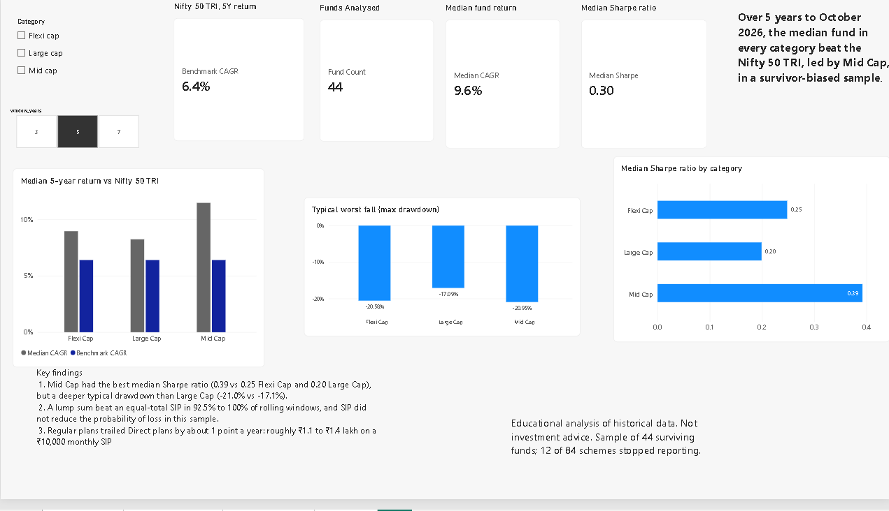
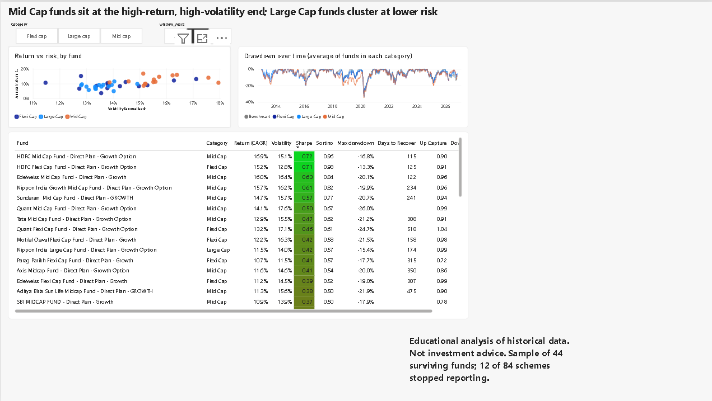
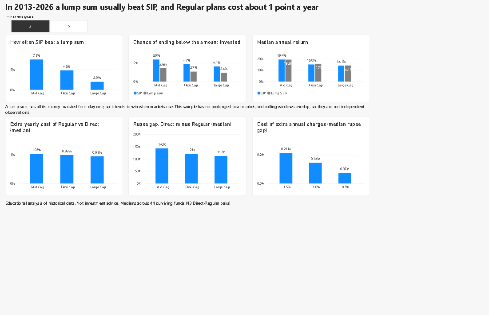

# Indian Equity Mutual Funds: Risk, SIP Timing and Cost Analysis

**Author:** Dhruv Lekhi
**Stack:** Python (pandas, scipy) · SQL (SQLite window functions) · Power BI
**Data:** AMFI NAVs via mfapi.in · Nifty 50 Total Returns Index (NSE Indices)

> Educational analysis of historical data. Not investment advice. Past performance does not predict future returns.

**In 30 seconds:** I analysed 44 Direct-plan equity funds (Large, Flexi and Mid Cap) against the Nifty 50 TRI. Mid Cap had the best median risk-adjusted return, a lump sum beat an equal-total SIP in 92.5%+ of rolling windows, and Regular plans cost about 1 percentage point a year versus Direct. The sample is survivor-biased, and I say how and by how much.



Walkthrough video (2 minutes): *[add link]*

---

## 1. Questions

For an Indian retail investor with a 5-year horizon:

1. How do Large Cap, Flexi Cap and Mid Cap funds compare on **risk-adjusted** returns, not just returns?
2. Does investing by **SIP** protect an investor better than a **lump sum**?
3. How much do **expense ratios** (Regular vs Direct plans) really cost?

## 2. Key findings

Windows end on 30 October 2026. The 5-year window starts in late October 2021. Benchmark: Nifty 50 TRI, **6.4% a year** over that window.

| Finding | Result |
|---|---|
| **Returns vs benchmark (5Y median)** | Mid Cap 11.5%, Flexi Cap 9.0%, Large Cap 8.2% a year, versus 6.4% for the TRI (median excess +5.1, +2.6 and +1.8 points) |
| **Risk-adjusted (5Y median Sharpe)** | Mid Cap 0.39, Flexi Cap 0.25, Large Cap 0.20 |
| **Risk taken (5Y median)** | Volatility 15.5% (Mid), 13.8% (Flexi), 13.5% (Large). Max drawdown -21.0% (Mid), -20.6% (Flexi), -17.1% (Large) |
| **Spread across funds** | 5Y annual return ranged from 3.6% to 16.9% across the 44 funds, so the choice of fund within a category mattered as much as the category |
| **SIP vs lump sum** | A lump sum ended ahead of an equal-total SIP in 92.5% to 100% of rolling windows, with similar annualised returns. SIP did **not** reduce the chance of ending below the amount invested in this sample |
| **Cost of Regular plans** | Across 43 fund pairs, the Regular plan trailed its own Direct plan by about **1.0 point a year**, which cost roughly **₹1.1 to ₹1.4 lakh** on a ₹10,000 monthly SIP (about 5% of the final corpus) |
| **Survivorship** | 12 of the 84 Large and Mid Cap Direct-Growth schemes found (6 in each) had stopped reporting and are missing from any analysis of current funds |

**How to read these honestly.** The median fund beating the index is partly a selection effect: funds were chosen by age among those still operating, which favours survivors. The 5-year window starts near the late-2021 market highs, so absolute returns are modest, and Sharpe ratios are low (also because the assumed risk-free rate is 6.5%). These are findings about this sample and period, not a forecast or a ranking of categories.

### SIP vs lump sum in detail

SIP of ₹10,000 a month versus the same total invested as a lump sum on day one, over every possible start month (Direct plans, 2013 to 2026). Values in %.

| Category | Horizon | Windows | SIP ends higher | Median SIP XIRR | Median lump-sum CAGR | 10th pct SIP / lump | Ends below invested: SIP / lump |
|---|---|---|---|---|---|---|---|
| Flexi Cap | 3Y | 1,860 | 4.8 | 15.0 | 15.7 | 4.5 / 6.5 | 4.7 / 2.7 |
| Flexi Cap | 5Y | 1,500 | 0.1 | 15.2 | 15.2 | 6.7 / 7.4 | 1.9 / 0.5 |
| Large Cap | 3Y | 1,913 | 2.0 | 14.1 | 14.1 | 4.4 / 7.2 | 4.1 / 2.4 |
| Large Cap | 5Y | 1,553 | 0.0 | 14.2 | 13.8 | 7.0 / 7.9 | 2.0 / 0.3 |
| Mid Cap | 3Y | 1,764 | 7.5 | 19.4 | 19.3 | 2.9 / 5.9 | 6.0 / 3.6 |
| Mid Cap | 5Y | 1,428 | 0.4 | 18.8 | 18.0 | 6.3 / 8.6 | 2.4 / 0.4 |

- A lump sum has all its money invested from day one, so in a market that mostly rose it wins on final rupees almost by construction. Annualised returns were similar, so both views are reported.
- The common advice that SIP limits downside is **not supported here**. The 2013 to 2026 sample contains the 2020 crash and the 2022 fall, but no prolonged bear market like 2008, which is where SIP's benefit is expected to show.
- Windows overlap heavily (about 1,400 to 1,900 per row from 15 or fewer funds), so they are not independent observations. Treat the percentages as descriptive.

### Cost of Regular vs Direct plans

| Category | Annual drag (median) | Corpus gap | Rupee gap on ₹10,000/month |
|---|---|---|---|
| Flexi Cap | 0.99% | 5.3% | ₹1,20,902 |
| Large Cap | 0.95% | 5.2% | ₹1,12,343 |
| Mid Cap | 1.03% | 5.7% | ₹1,42,977 |

Measured from the same fund's Direct and Regular NAVs over up to 10 years. A second test subtracts extra annual cost from every Direct fund's returns (median result):

| Extra annual cost | Rupee gap | Share of final corpus |
|---|---|---|
| 0.5% | ₹73,520 | 3.0% |
| 1.0% | ₹1,44,425 | 6.0% |
| 1.5% | ₹2,12,816 | 8.8% |

The two methods agree: a drag of about 1 point a year costs about 5 to 6% of the final corpus.

## 3. Dashboard

Built in Power BI Desktop: `dashboard/mf_dashboard.pbix` . The model is a star schema with a `dim_category` table filtering eight fact tables, plus DAX measures for medians, SIP win rate and cost gaps.

| Page | What it shows |
|---|---|
| **Overview** | Median return vs benchmark, Sharpe and drawdown by category, with window and category slicers |
| **Fund explorer** | Return vs risk scatter for all 44 funds, drawdown history, and a sortable table of every fund with a colour-coded Sharpe column |
| **SIP and cost** | SIP vs lump sum win-rate, loss probability and returns; cost of Regular plans in percent and rupees |
| **Notes** | Data, method and limitations |




## 4. Data

| Item | Detail |
|---|---|
| Universe | 44 funds: 15 Flexi Cap, 15 Large Cap, 14 Mid Cap. Direct plan, Growth option only |
| Selection | Active funds with at least 8 years of NAV history, oldest first, up to 15 per category |
| NAV source | AMFI data through mfapi.in. 43 Direct funds have a matched Regular-plan twin for the cost study |
| Benchmark | Nifty 50 Total Returns Index (gross), 2,683 daily observations from 1 Jan 2016 to 30 Oct 2026. Downloaded from NSE Indices and not redistributed in this repo |
| Direct plan history | Direct plans began in 2013, so Direct-plan analyses cover 2013 to 2026 |

### Data quality

23 issues were flagged automatically (gaps over 7 days, daily NAV moves over 15%) and reviewed:

- All 23 relate to **Regular-plan** NAV history from 2007 to 2009, which predates Direct plans.
- 19 of the large moves fall on the same date, 19 May 2009, across about 20 funds at once: a market-wide rally, not a data error. They are kept.
- Some early NAVs are reported weekly, so some flagged "one-day" moves are weekly changes.
- None of the flagged data falls inside the 3, 5 or 7-year windows behind the risk and return metrics.

## 5. Method

**Common window.** Every fund is measured over the same end date, so no fund is judged through a crash that another one avoided.

| Metric | Definition |
|---|---|
| CAGR | (end NAV / start NAV)^(365.25/days) - 1 |
| Volatility | Standard deviation of daily returns x sqrt(252) |
| Sharpe | Mean excess return over the risk-free rate / its standard deviation, annualised. Risk-free rate assumed at 6.5% |
| Sortino | Like Sharpe but only downside deviation in the denominator |
| Beta, alpha | Regression of fund excess returns on benchmark excess returns |
| Tracking error, information ratio | Spread of (fund - benchmark) returns, and active return per unit of it |
| Up / down capture | Average fund return over average benchmark return on up and down days |
| Max drawdown, days to recover | Worst peak-to-trough fall in the window; time from trough back to the old peak |
| XIRR | Money-weighted annual return for SIP cash flows on unequal dates |

**SIP study.** For each fund, horizon (3Y, 5Y) and start month: SIP of ₹10,000 on the first NAV date of each month versus the same total as a lump sum on the first date. Both are valued on the same end date.

**Cost study.** Same fund, Direct vs Regular NAVs through an identical SIP, plus a sensitivity test with extra annual cost of 0.5%, 1.0% and 1.5%.

**Correlation and clusters.** Step 6 computes weekly-return correlations over 3 years, clusters funds by behaviour, and lists near-duplicate pairs (outputs in `data/processed/`). In a 3-year sample of 157 weekly returns, all 15 Large Cap funds and 12 of 14 Mid Cap funds fell into clusters matching their SEBI category, but Flexi Cap did not form a cluster of its own: 10 of 15 behaved like Large Cap funds and 2 like Mid Cap funds, and 3 were outliers. This suggests the Flexi Cap label says little about how a fund behaves, and that holding a Large Cap and a Flexi Cap fund together may add less diversification than the labels imply. The number of clusters was set to 6, so the small clusters mainly flag outlier funds.


**Quality control.** 19 unit tests check metrics against hand-computed answers (drawdowns, Sharpe, beta, XIRR, SIP arithmetic). A validation step runs integrity checks before the data reaches the dashboard. Published figures were cross-checked against an independent source: the benchmark's 5-year return (6.4%) is in line with published Nifty 50 TRI figures for a similar period.

## 6. Limitations

1. **Survivorship and selection bias.** Funds that closed or merged are missing, and "oldest first" favours survivors. This likely flatters fund returns versus the index. The 12 stopped schemes quantify part of the problem. A random-selection re-run (`SELECTION_METHOD = "random"` in `config.py`) is the natural next test.
2. **Flexi Cap is a young label.** SEBI created the category in 2020, so older history for these funds was reported under earlier categories.
3. **One regime.** The 5-year window starts near the late-2021 highs and ends in a weak period, so returns and Sharpe ratios are low.
4. **No prolonged bear market in the Direct-plan era**, which limits what the SIP study can say about SIP's downside protection.
5. **Overlapping windows** inflate the apparent sample size in the SIP study.
6. **Risk-free rate** is an assumption (6.5%). It changes Sharpe levels more than rankings.
7. **No taxes, exit loads or stamp duty** are modelled.
8. **Medians of 14 to 15 funds per category** are sensitive to a few funds. Differences of a point or two are not conclusive.
9. **Averages in charts.** The drawdown-over-time chart shows the average across funds in a category, from each fund's full history, and does not follow the window slicer.

## 7. Reproduce it

Requires Python 3.10 or newer.

```bash
python -m venv .venv
.venv\Scripts\activate            # Mac/Linux: source .venv/bin/activate
pip install -r requirements.txt
```

**Benchmark.** Download the Nifty 50 *Total Returns Index* daily history from niftyindices.com (Reports > Historical Data). The site allows one year per download, so save each year's CSV into `data/raw/tri_chunks/` and run `python src/merge_tri.py`. If `data/raw/nifty50_tri.csv` is missing, step 1 falls back to a Nifty 50 index-fund proxy and labels it.

```bash
python src/01_select_and_download.py     # fund universe, NAV download, survivorship check
python src/02_build_database.py          # SQLite database + data-quality log
python src/03_metrics.py                 # risk/return metrics, rolling returns (SQL), drawdowns
python src/04_sip_vs_lumpsum.py          # SIP vs lump sum
python src/05_expense_impact.py          # Direct vs Regular cost study
python src/06_correlation_clusters.py    # correlation, clusters, near-duplicates
python src/08_validate_and_export.py     # integrity checks
pytest -q                                # unit tests
```

Settings (fund count, windows, risk-free rate, selection method) are in `config.py`. `python run_all.py --offline-test` runs the analysis steps on simulated data as a dry run; never publish numbers from that mode.

**Optional extension (not used for the published results):** `src/07_llm_summaries.py` generates plain-English fund summaries with the Claude API and validates each one for invented numbers and advice-style words. It needs an API key and is not part of the results above.

```
config.py              settings
src/                   pipeline scripts, metrics_lib.py, common.py
sql/                   window-function views and rolling returns
tests/                 unit tests and synthetic-data generator
dashboard/             Power BI file 
docs/images/           dashboard screenshots
data/processed/        outputs behind the dashboard (CSV)
data/raw/              fund list (raw NAV and benchmark downloads are not committed)
```

## 8. What I would do next

- Re-run with random fund selection to test how much the benchmark result depends on survivorship.
- Extend the SIP study to Regular-plan history back to 2007 to include the 2008 bear market (early NAVs are weekly).
- Add fund-overlap analysis using portfolio holdings.

---
*Educational analysis of historical data. Not investment advice.*
